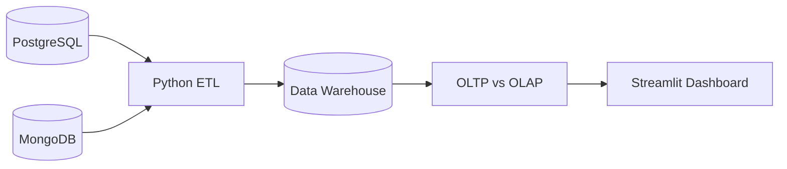

<div align="center">

# 🚀 Raiseup CRM
### A CRM & Data Engineering Platform


</div>

A CRM application that combines **PostgreSQL, MongoDB, Python ETL, and Streamlit** to manage user data and explore analytics.

## 📊 Project Screenshots

| Users Analytics | OLTP vs OLAP |
|:---:|:---:|
|  |  |

| ETL Pipeline | Kafka Integration |
|:---:|:---:|
|  |  |

<details>
<summary>Login Screen</summary>


</details>

## 🏗️ Architecture



## 🧰 Tech Stack

- **Languages:** Python, SQL
- **Databases:** PostgreSQL, MongoDB
- **Data Engineering:** ETL, Data Warehousing, Star Schema
- **Streaming:** Apache Kafka
- **Processing:** PySpark
- **Dashboard:** Streamlit
- **Infrastructure:** Docker Compose

## 📁 Project Structure

```text
Raiseup_CRM/
├── sql/
│   ├── app_users.sql
│   ├── posts.sql
│   ├── users.sql
│   └── partitioned.sql
├── screenshots/
├── ETL.py
├── OLTP_OLAP.py
├── app.py
├── docker-compose.yaml
└── requirements.txt
```

## ▶️ Run Locally

```bash
git clone https://github.com/Ah-Hany/Raiseup_CRM.git
cd Raiseup_CRM
docker compose up -d
pip install -r requirements.txt
streamlit run app.py
```

## 👨‍💻 Author

**Ahmed Hany**

- [GitHub](https://github.com/Ah-Hany)
- [LinkedIn](https://www.linkedin.com/in/ahmed-hany-b30692431/)
-
