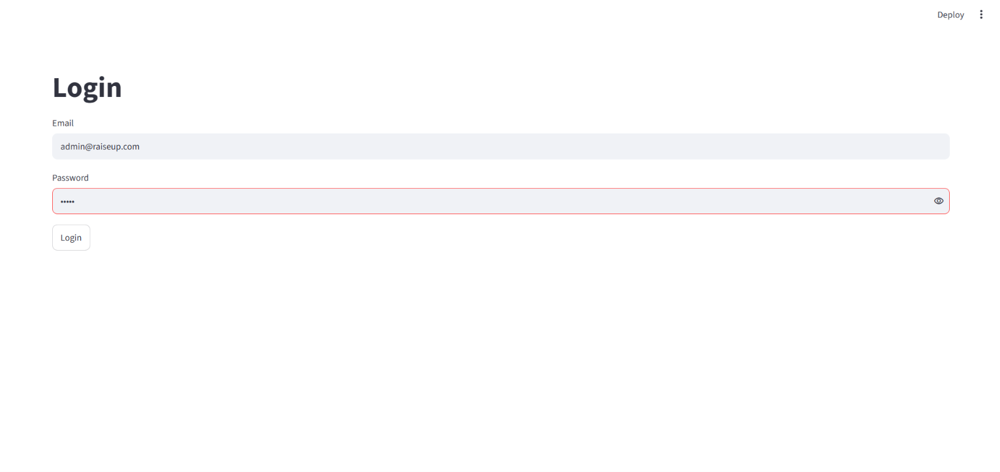
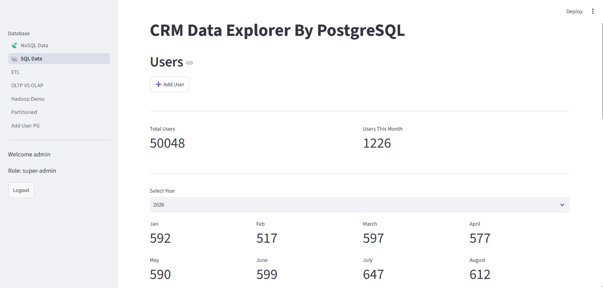

# 🚀 Raiseup CRM & Data Engineering Platform

<p align="center">
  
</p>

<p align="center">
  
  
  
  
  
</p>

---

## 📌 About The Project

An enterprise-grade CRM and Data Engineering platform designed to handle hybrid data sources (Relational & NoSQL), process them through robust ETL workflows, and load them into a centralized **Data Warehouse** structured as a **Star Schema** for advanced OLAP analytics.

---

## 🏗️ System Architecture & Data Flow

```text
[ PostgreSQL (OLTP) ] ──┐
                         ├──> [ Python ETL Pipelines ] ──> [ Data Warehouse (Star Schema) ] ──> [ Streamlit Analytics ]
[ MongoDB (NoSQL) ]    ──┘
```

---

## 📂 Repository Structure

```text
Raiseup_CRM/
│
├── sql/
│   ├── app_users.sql
│   ├── posts.sql
│   ├── users.sql
│   └── partitioned.sql
│
├── screenshots/
│
├── ETL.py
├── OLTP_OLAP.py
├── app.py
├── docker-compose.yaml
└── requirements.txt
```

---

## 📊 Data Warehouse Design (Star Schema)

The Data Warehouse is optimized for analytical queries (OLAP), featuring:

- **Fact Tables:** Transactional and activity logs (posts, user actions).
- **Dimension Tables:** Master data entities (users, app_users).
- **Performance Optimization:** Indexing and table partitioning to support high-volume analytical queries.

SQL scripts are available in the `sql/` directory.

---

## 🚀 Getting Started

### Prerequisites

- Python 3.10+
- Docker & Docker Compose
- PostgreSQL
- MongoDB

### Installation & Run

**1. Clone the repository**

```bash
git clone https://github.com/Ah-Hany/Raiseup_CRM.git
cd Raiseup_CRM
```

**2. Start databases using Docker**

```bash
docker-compose up -d
```

**3. Install dependencies**

```bash
pip install -r requirements.txt
```

**4. Run the Streamlit application**

```bash
streamlit run app.py
```

---

## 📸 Screenshots

| Users Analytics | OLTP vs OLAP Dashboard |
|---|---|
|  |  |

---

## 🛠️ Tech Stack

- **Languages:** Python, SQL
- **Databases:** PostgreSQL, MongoDB
- **ETL:** Custom Python ETL Pipelines
- **Orchestration & Deployment:** Docker, Docker Compose
- **Visualization:** Streamlit
- **Data Modeling:** Star Schema, OLTP & OLAP

---

## 👨‍💻 Author

**Ahmed Hany**

GitHub: [Ah-Hany](https://github.com/Ah-Hany)
