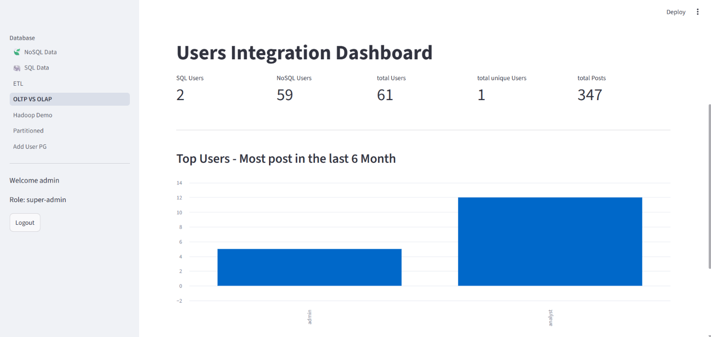
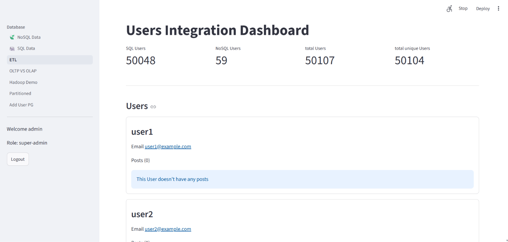
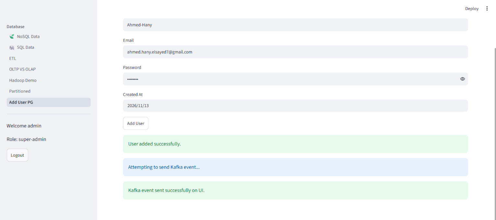
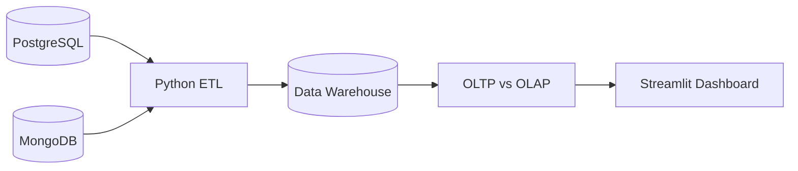

<div align="center">

# 🚀 Raiseup CRM
### CRM & Data Engineering Platform


</div>

A CRM and Data Engineering project integrating PostgreSQL, MongoDB, Python ETL, Kafka, and Streamlit for data management and analytics.

## 📊 Project Screenshots

| Users Analytics | OLTP vs OLAP |
|:---:|:---:|
|  |  |

| ETL Pipeline | Kafka Integration |
|:---:|:---:|
|  |  |

<details>
<summary>🔐 CRM Login</summary>


</details>

## 🏗️ Architecture



## 📁 Project Structure

```text
Raiseup_CRM/
│
├── sql/
│   ├── app_users.sql
│   ├── posts.sql
│   ├── users.sql
│   └── partitioned.sql
│
├── screenshots/
│   ├── crm_login.png
│   ├── users_analytics.png
│   ├── oltp_vs_olap_dashboard.png
│   ├── etl_pipeline.png
│   └── add_user_kafka.png
│
├── dags/
│   └── crm_test_dag.py
│
├── app.py
├── add_user_page.py
├── chatbot.py
├── crud.py
├── ETL.py
├── hadoop.py
├── Mongodb.py
├── OLTP_OLAP.py
├── Orchestrations.py
├── partitioned.py
├── postgres.py
│
├── docker-compose.yaml
└── requirements.txt
```

## 🛠️ Tech Stack

- Python & SQL
- PostgreSQL
- MongoDB
- Apache Kafka
- ETL & Data Warehousing
- Star Schema
- PySpark
- Streamlit
- Docker & Docker Compose
- Apache Airflow

## ▶️ Run Locally

```bash
git clone https://github.com/Ah-Hany/Raiseup_CRM.git

cd Raiseup_CRM

docker compose up -d

pip install -r requirements.txt

streamlit run app.py
```

## 👨‍💻 Author

**Ahmed Hany**

- GitHub: [Ah-Hany](https://github.com/Ah-Hany)
- LinkedIn: [Ahmed Hany](https://www.linkedin.com/in/ahmed-hany-b30692431/)

